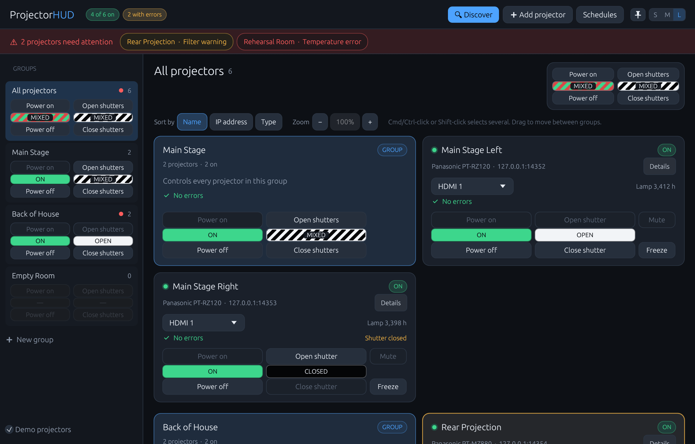
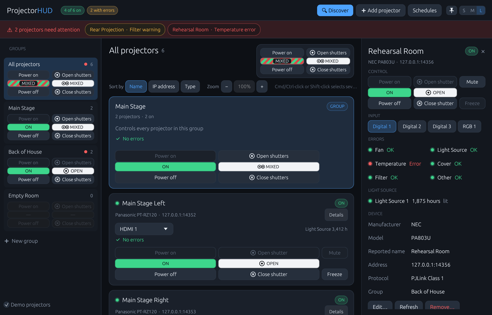
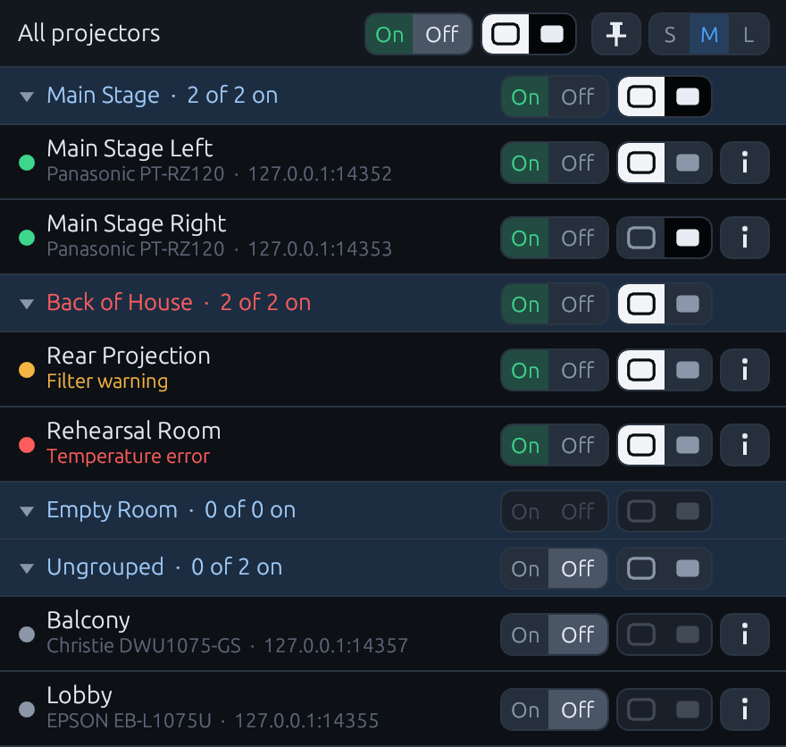
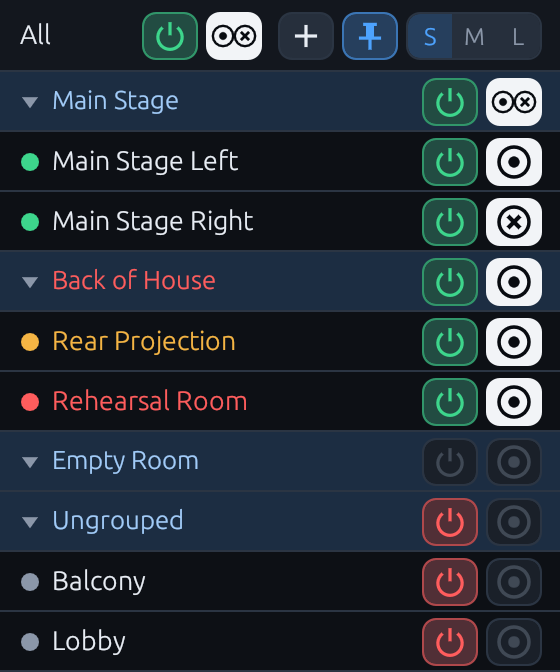

<div align="center">


# ProjectorHUD

**Monitor and control a fleet of networked projectors from one window.**

Free, open source, and cross-platform. Written in Rust.

[](https://github.com/r2a42/ProjectorHUD/releases/latest)
[](https://github.com/r2a42/ProjectorHUD/actions/workflows/ci.yml)
[](LICENSE)


[**Download**](https://github.com/r2a42/ProjectorHUD/releases/latest) · [What it does](#what-it-does) · [Three window sizes](#three-window-sizes) · [Protocols](#protocols) · [Build](#build-and-run)

</div>



## Download

Get the latest build from the [releases page](https://github.com/r2a42/ProjectorHUD/releases/latest). It is a single program with nothing else to install.

| Platform | File | Notes |
| --- | --- | --- |
| **macOS** 11+ (Apple Silicon and Intel) | `ProjectorHUD-vX.Y.Z-macos-universal.zip` | Signed and notarised by Apple. Unzip and move to Applications. |
| **Windows** 10/11 (x64) | `ProjectorHUD-vX.Y.Z-windows-x64.zip` | Not code-signed yet: SmartScreen may ask, choose *More info → Run anyway*. |
| **Linux** (x64, glibc 2.35+) | `ProjectorHUD-vX.Y.Z-linux-x64.tar.gz` | Needs OpenGL and X11 or Wayland. |

No projectors to hand? Tick **Demo projectors** in the app to try everything on six simulated ones.

## What it does

- **Control**: power on/off, shutter (picture mute), audio mute, input selection, freeze and volume (PJLink Class 2).
- **Act on many at once**: power or shutter every projector, or just one group, with a single click.
- **Status at a glance**: live power state, input, light source hours, and model for every projector.
- **Faults are impossible to miss**: fan, light source, temperature, cover and filter problems, plus projectors that drop off the network, turn the card red or amber and appear in a banner across the top of the window.
- **Discovery**: finds projectors on your LAN by PJLink broadcast search and by sweeping each local subnet. Other subnets/VLANs can be scanned by prefix.
- **Groups**: organize projectors by room or rig. Each group has its own card that controls every projector in it; select several projectors (Cmd/Ctrl-click, Shift-click) and drag them between groups; double-click a group to rename it.
- **Sorting and zoom**: sort by name, IP address or type, and zoom in or out to fit more projectors on screen.
- **Schedules**: timed power and shutter commands by day of week (while the app is open).
- **Command log**: every byte exchanged with a projector, for troubleshooting.
- **Demo mode**: six simulated projectors, so you can try everything without hardware.



## Three window sizes

The **S / M / L** switch at the top right turns the whole app into a small window that can sit in a corner of the screen during a show. The pin next to it keeps the window on top of other programs.

| Medium: a short list | Small: a strip of buttons |
| :---: | :---: |
|  |  |
| Name, fault or address, an On/Off switch, a shutter switch and a details button for every projector. | One line per projector. The power button is green when on and red when off. The shutter button shows a lens when open and an X when closed. |

In both, a group's row controls the whole group, and clicking it folds the group away to make the window smaller still. Right-click a projector for details, edit, move to group and remove; details and editing open in a little window of their own.

## Protocols

| Protocol | Port | Notes |
| --- | --- | --- |
| **PJLink** Class 1 and 2 | TCP 4352 | The default. Supported by Panasonic, Epson, NEC/Sharp, Sony, Christie, Barco, Optoma, BenQ, Canon, Hitachi/Maxell and most others. Works without a password when the projector has none set; MD5 password authentication is supported when it does. |
| **Panasonic native** (NTCONTROL) | TCP 1024 | Experimental alternative for Panasonic units. Power, shutter, input, freeze, light source hours. It does not report fault status, so PJLink is preferred for monitoring. |

Network control usually has to be enabled in the projector's menu (on Panasonic: *Network → Network Control → PJLink Control: On*).

### Reliability

Each projector has its own worker thread, so one slow or dead unit never stalls the rest. Connections are kept open and re-established transparently when a projector closes an idle session; a single missed poll is tolerated before a projector is shown offline; and offline projectors are retried with backoff (2 s up to 20 s) and recover on their own.

## Build and run

Install [Rust](https://rustup.rs), then:

```bash
cargo run --release
```

On Linux you need the usual windowing development packages first (Debian/Ubuntu: `libxcb-render0-dev libxcb-shape0-dev libxcb-xfixes0-dev libxkbcommon-dev libgtk-3-dev`).

To run the simulated projectors on their own (PJLink on `127.0.0.1:14352`–`14357`), for testing other control software:

```bash
cargo run --release -- --sim
```

## Tests

```bash
cargo test
```

The test suite runs the real drivers and worker threads over TCP against the built-in simulator: authentication, Class 1 and Class 2 behaviour, fault reporting, dropped connections and recovery.

## Configuration

Settings are stored as JSON in the platform config directory (`~/Library/Application Support/ProjectorHUD/config.json` on macOS). Projector passwords are stored in that file, readable only by your user account. PJLink authentication is not strong security in any case; keep projectors on a trusted network.

## Status

Verified against the built-in simulator and by discovering real PJLink projectors on a LAN. Panasonic native control was written from protocol documentation and has not yet been exercised against hardware. Reports from real rigs are welcome.

## License

MIT
