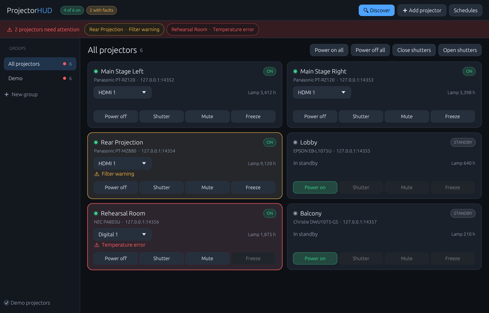
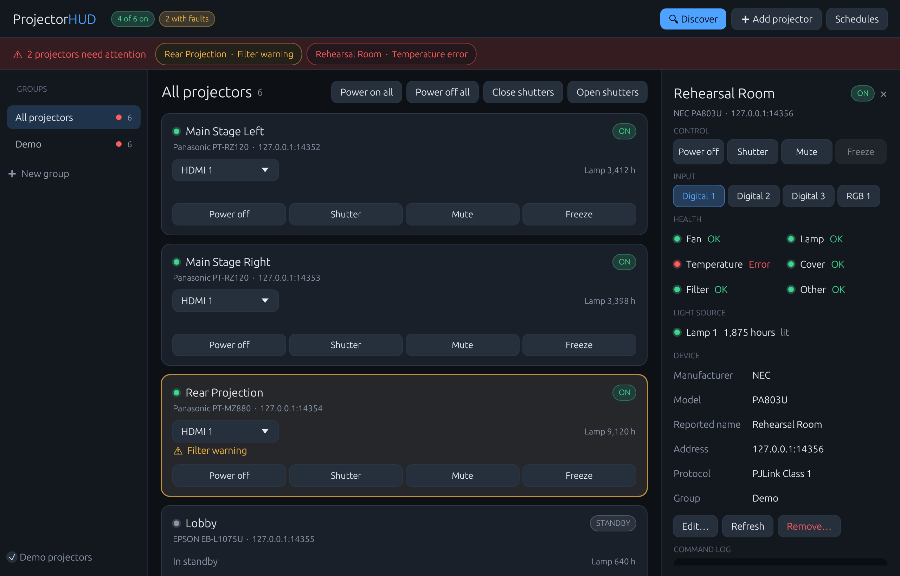

# ProjectorHUD

Monitor and control a fleet of networked projectors from one window. Free, open source, and cross-platform (macOS, Windows, Linux), written in Rust.



## What it does

- **Control**: power on/off, shutter (picture mute), audio mute, input selection, freeze and volume (PJLink Class 2).
- **Act on many at once**: power or shutter every projector, or just one group, with a single click.
- **Status at a glance**: live power state, input, lamp hours, and model for every projector.
- **Faults are impossible to miss**: fan, lamp, temperature, cover and filter problems, plus projectors that drop off the network, turn the card red or amber and appear in a banner across the top of the window.
- **Discovery**: finds projectors on your LAN by PJLink broadcast search and by sweeping each local subnet. Other subnets/VLANs can be scanned by prefix.
- **Groups**: organize projectors by room or rig.
- **Schedules**: timed power and shutter commands by day of week (while the app is open).
- **Command log**: every byte exchanged with a projector, for troubleshooting.
- **Demo mode**: six simulated projectors, so you can try everything without hardware.



## Protocols

| Protocol | Port | Notes |
| --- | --- | --- |
| **PJLink** Class 1 and 2 | TCP 4352 | The default. Supported by Panasonic, Epson, NEC/Sharp, Sony, Christie, Barco, Optoma, BenQ, Canon, Hitachi/Maxell and most others. Works without a password when the projector has none set; MD5 password authentication is supported when it does. |
| **Panasonic native** (NTCONTROL) | TCP 1024 | Experimental alternative for Panasonic units. Power, shutter, input, freeze, lamp hours. It does not report fault status, so PJLink is preferred for monitoring. |

Network control usually has to be enabled in the projector's menu (on Panasonic: *Network → Network Control → PJLink Control: On*).

### Reliability

Each projector has its own worker thread, so one slow or dead unit never stalls the rest. Connections are kept open and re-established transparently when a projector closes an idle session; a single missed poll is tolerated before a projector is shown offline; and offline projectors are retried with backoff (2 s up to 20 s) and recover on their own.

## Build and run

Install [Rust](https://rustup.rs), then:

```bash
cargo run --release
```

On Linux you need the usual windowing development packages first (Debian/Ubuntu: `libxcb-render0-dev libxcb-shape0-dev libxcb-xfixes0-dev libxkbcommon-dev libgtk-3-dev`).

To run the simulated projectors on their own (PJLink on `127.0.0.1:14352`–`14357`), for testing other control software:

```bash
cargo run --release -- --sim
```

## Tests

```bash
cargo test
```

The test suite runs the real drivers and worker threads over TCP against the built-in simulator: authentication, Class 1 and Class 2 behaviour, fault reporting, dropped connections and recovery.

## Configuration

Settings are stored as JSON in the platform config directory (`~/Library/Application Support/ProjectorHUD/config.json` on macOS). Projector passwords are stored in that file, readable only by your user account. PJLink authentication is not strong security in any case; keep projectors on a trusted network.

## Status

Verified against the built-in simulator and by discovering real PJLink projectors on a LAN. Panasonic native control was written from protocol documentation and has not yet been exercised against hardware. Reports from real rigs are welcome.

## License

MIT
